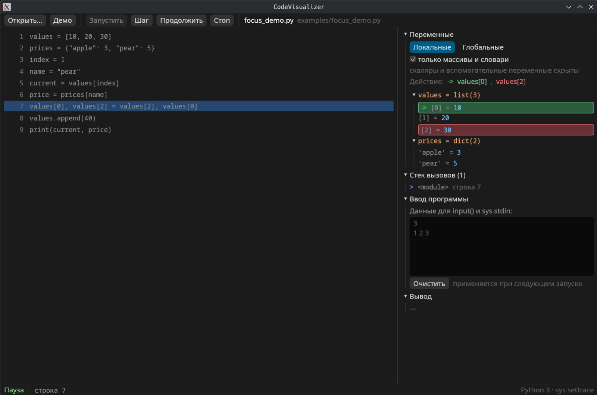

# CodeVisualizer

**Пошаговый визуализатор выполнения Python-кода** для Linux: текущая строка,
значения переменных, стек вызовов и вывод программы — в одном окне.

[](https://www.rust-lang.org)
[](https://www.python.org)
[](LICENSE)


## Возможности

- открытие `.py` файла: диалог, перетаскивание в окно или аргумент командной строки;
- подача входных данных для `input()` и `sys.stdin`;
- кнопки **Запустить**, **Шаг**, **Продолжить**, **Стоп**;
- подсветка текущей строки с автопрокруткой;
- подсветка самих элементов списков, матриц и словарей, с которыми работает текущая строка: активный элемент зелёный, элемент обмена — красный;
- только одна стрелка `->` — у активного элемента;
- плавная анимация перестановки элементов списка: при сортировке и обмене строки съезжают на новые места, а не меняются мгновенно;
- режим **«только массивы и словари»**: скаляры и служебные переменные скрыты;
- дерево локальных и глобальных переменных: списки, кортежи, словари и объекты с такими полями;
- стек вызовов с номерами строк;
- перехват `print` и вывода в `stderr`;
- показ необработанного исключения вместе с состоянием на месте ошибки;
- нативный интерфейс на Rust + egui, работает на Wayland и X11;
- демо-пример `examples/demo.py` (пузырьковая сортировка и рекурсивный `fib`).

## Быстрый старт

### 1. Зависимости для сборки из исходников

Нужны Python 3.10+, Rust 1.95+ и шрифты с кириллицей. Готовый архив из
**Releases** собирать не нужно — Python уже лежит внутри (см. ниже).

Arch Linux:

```bash
sudo pacman -S --needed python noto-fonts gcc pkgconf
curl --proto '=https' --tlsv1.2 -sSf https://sh.rustup.rs | sh
source "$HOME/.cargo/env"
```

Другие дистрибутивы: установите Python 3.10+, компилятор C, `pkg-config` и
Rust через [rustup.rs](https://rustup.rs). Для диалога выбора файла нужен
`xdg-desktop-portal` (обычно уже установлен в KDE и GNOME).

### 2. Запуск

Скачайте репозиторий (Code → Download ZIP) или склонируйте его, затем:

```bash
cd CodeVisualizer
./run.sh examples/demo.py
```

`run.sh` сам соберёт release-версию и запустит приложение. Без аргумента
откроется пустое окно — файл можно выбрать кнопкой «Открыть…», перетащить в
окно, вставить путь в поле на главном экране или нажать «Демо».

Можно запускать и напрямую через Cargo:

```bash
cargo run --release --locked -- examples/demo.py
```

### Готовый бинарник

Если не хочется собирать вручную, скачайте архив из раздела **Releases**:

```bash
tar -xzf codevisualizer-linux-x86_64.tar.gz
./codevisualizer examples/demo.py
```

В архив уже входит портативный Python 3.12, поэтому ни Python, ни Rust
устанавливать не нужно. Если в системе есть Python 3.10+, приложение
использует его (вместе с установленными пакетами); иначе берёт встроенный
Python со стандартной библиотекой. Нужен только x86_64 Linux с glibc 2.35+ и
обычным графическим окружением (Wayland или X11): Ubuntu 22.04+, Debian 12+,
Arch Linux, Fedora 36+.

Если на системе нет `xdg-desktop-portal`, диалог «Открыть…» может быть
недоступен — перетащите файл в окно, вставьте путь на главном экране или
запустите `./codevisualizer file.py`.

Встроенный Python содержит только стандартную библиотеку. Если скрипту нужны
сторонние пакеты, поставьте их в него:

```bash
./python-runtime/bin/python3 -m pip install numpy
```

## Установка в меню приложений

```bash
./install.sh
```

Скрипт соберёт release-версию, скопирует бинарник в `~/.local/bin`, установит
ярлык и иконку в `~/.local/share`. После этого CodeVisualizer появится в меню
KDE и в списке «Открыть с помощью» для `.py` файлов.

Удаление:

```bash
./install.sh --uninstall
```

## Управление

| Кнопка | Действие |
|---|---|
| Запустить | запускает Python-трейсер и останавливается на первой строке |
| Шаг | выполняет одну строку и останавливается на следующей |
| Продолжить | выполняет программу до конца (точек останова пока нет) |
| Стоп | завершает процесс Python |

Слева — код с подсветкой текущей строки. Справа — переменные, стек вызовов и
вывод программы. Переменные можно сворачивать и разворачивать, как в обычном
отладчике.

## Ввод данных

Если скрипт использует `input()` или читает `sys.stdin`, откройте справа
раздел **«Ввод программы»** и вставьте данные в том виде, в каком они обычно
подаются в консоль. Например, для скрипта:

```python
n = int(input())
numbers = [int(input()) for _ in range(n)]
print(sum(numbers))
```

нужно вставить:

```text
3
10
20
30
```

Данные применяются при следующем запуске. Для задач, которые читают ввод до
`EOF` (например, цикл `while True: input()`), просто вставьте все строки —
концом ввода будет конец текста. Локальные модули рядом со скриптом тоже
поддерживаются: их каталог добавляется в `sys.path`.

## Подсветка элементов

Когда текущая строка обращается к элементу списка, матрицы или словаря, сам
элемент в панели переменных выделяется зелёным фоном и рамкой, а слева
появляется стрелка `->`. Если на строке происходит обмен, активный элемент
остаётся зелёным со стрелкой, а элемент, с которым его меняют, выделяется
красным без стрелки. Например, на строке:

```python
values[0], values[2] = values[2], values[0]
```

`values[0]` будет зелёным с `->`, а `values[2]` — красным без стрелки. Стрелка
всегда одна.

Когда элементы меняются местами во время сортировки или обмена, их строки
плавно переезжают на новые позиции в течение половины секунды. Это работает
для числовых и строковых элементов списков и вложенных списков матриц.

Поддерживаются:

- `values[index]`, `matrix[row][col]` — матрица раскрывается как вложенные списки;
- `prices[name]`, вложенные `data[key][index]`;
- `obj.items[i]` для атрибутов объектов;
- вызовы `values.append(...)`, `prices.get(...)` — выделяется сам список или словарь.

Если индекс — вызов функции или слишком сложное выражение, указатель не
строится: трейсер не выполняет пользовательский код ради анализа. Пример:
`examples/focus_demo.py`.

По умолчанию включён режим **«только массивы и словари»**: в панели остаются
списки, кортежи, матрицы, словари и объекты, содержащие такие структуры.
Скаляры вроде `i`, `n`, `temp` скрыты — снимите галочку, чтобы показать все
переменные. Строка кода при этом подсвечивается только как текущая; акцент
сделан именно на элементах данных.



## Как это работает

```
Rust + egui (UI)  ←— JSON-строки через stdin/stdout —→  python/tracer.py
      │                                                       │
 подсветка элементов,                                sys.settrace,
 дерево переменных,                                  снимки f_locals/f_globals,
 стек вызовов, вывод                                 перехват stdout/stderr
```

- `src/main.rs` — точка входа, шрифты и оформление;
- `src/app.rs` — интерфейс и состояние приложения;
- `src/tracer.rs` — запуск Python-процесса и протокол обмена;
- `src/value.rs` — отображение сериализованных значений Python;
- `python/tracer.py` — трейсер (встраивается в бинарник через `include_str!`).

При запуске по умолчанию используется системный `python3` (3.10+), чтобы были
доступны установленные пользователем пакеты. Если его нет, готовый архив
берёт Python из `python-runtime/`.

Python-скрипт выполняется в отдельном процессе. Трейсер останавливается на
каждой строке, сериализует состояние в JSON и ждёт команду `step`, `continue`
или `stop`. Rust-интерфейс читает эти сообщения и обновляет окно.

## Сборка

```bash
cargo build --release --locked
./target/release/codevisualizer examples/demo.py
```

Готовый бинарник: `target/release/codevisualizer` (Linux x86_64).

## Релиз

```bash
git tag v0.2.3
git push origin v0.2.3
```

Workflow `.github/workflows/release.yml` соберёт
`codevisualizer-linux-x86_64.tar.gz` с Python 3.12 внутри и прикрепит архив к
GitHub Releases.

## Разработка

```bash
cargo fmt --check
cargo clippy --all-targets -- -D warnings
cargo test
```

Для отладки интерфейса есть переменные окружения:

```bash
CODEVISUALIZER_AUTOSTART=1 CODEVISUALIZER_AUTOSTEPS=20 \
  ./target/debug/codevisualizer examples/demo.py
```

`AUTOSTART` сразу запускает трейсер, `AUTOSTEPS` автоматически делает указанное
число шагов. Переменная `CODEVISUALIZER_PYTHON=/path/to/python3` позволяет
запустить трейсер другим интерпретатором.

## Ограничения текущей версии

- трассируется только выбранный файл; код импортированных модулей не подсвечивается;
- ввод программы задаётся заранее; интерактивный диалог с `input()` во время выполнения не поддерживается;
- потоки, запущенные программой, не трассируются;
- нет точек останова и условных остановок;
- «Продолжить» всегда выполняет программу до конца;
- интерфейс приложения пока на русском языке.

## Дорожная карта

- [ ] точки останова по клику на номер строки;
- [ ] подсветка синтаксиса Python;
- [ ] графические диаграммы структур данных (столбики для списков, деревья);
- [ ] трассировка импортированных модулей;
- [ ] английская локализация интерфейса.

## Лицензия

MIT — см. [LICENSE](LICENSE).

---

**English:** CodeVisualizer is a step-by-step Python execution visualizer for
Linux, built with Rust + egui and Python's `sys.settrace`. It shows the current
line, variables, call stack and program output, highlights the list/array/dict
elements used by the current line (the active element in green with a single
pointer, its swap source in red without a pointer), animates list rows when
they move during swaps and sorting, and can hide scalar helper variables so only
data structures remain. The prebuilt release
bundles Python 3.12 and needs no Rust or Python installation; it prefers the
system Python 3.10+ when available (so pip packages work), otherwise falls back
to the bundled interpreter. Scripts can read stdin through the "Ввод программы"
panel. Building from source requires Rust 1.95+ and Python 3.10+. MIT licensed.
